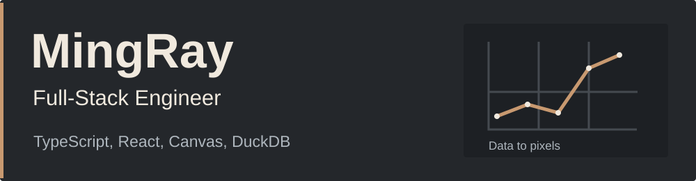
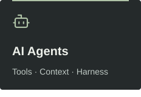
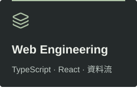
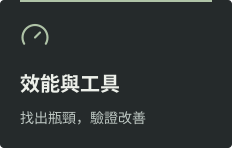
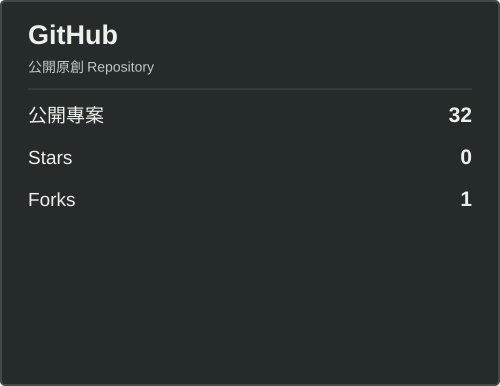
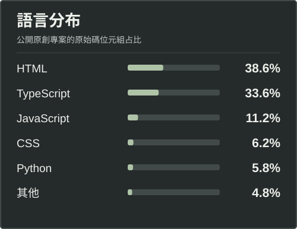

<picture>
  <source media="(max-width: 600px)" srcset="assets/header-mobile.svg" />
  
</picture>

# MingRay｜Full-Stack Engineer

我是 MingRay，從 Frontend 走向 Full Stack。目前的工作以 TypeScript、React、Canvas 與 DuckDB 為主，處理大型資料的查詢、圖表繪製與互動效能。

工作之外，我做第一人稱 3D 遊戲、瀏覽器影像工具與全端應用，也把實作過程中的問題、技術選擇與驗證方式整理成繁中筆記。

[技術部落格](https://ntustray.github.io/mr-blog/) · [GitHub Kanban](https://github-kanban-ntustray.vercel.app/) · [公開 Repositories](https://github.com/ntustRay?tab=repositories)

##  精選 Side Projects

| 專案 | 已實作的功能 | 技術重點 | 入口 |
| --- | --- | --- | --- |
| **慢慢停 · Parallel Parking Lab** | 第一人稱停車遊戲；三面後視鏡、路邊停車、倒車入庫、S 彎與迴轉，附分步教學與示範。 | Three.js、WebGL、車輛動態與碰撞判定；可打包成單一離線 HTML。 | [開始練習](https://ntustray.github.io/parallel-parking-lab/) · [Source](https://github.com/ntustRay/parallel-parking-lab) |
| **工程師選股網** | 台股多條件選股、個股行情與財報、公司比較、會員追蹤清單。 | Next.js、TypeScript、ECharts、Supabase Auth；股票資料由 GitHub Actions 更新 JSON，會員資料另外保存。 | [Demo](https://engineer-stock-web.vercel.app/) · [公開資料 Pipeline](https://github.com/ntustRay/engineer-stock-data) |
| **Shade Lab · AR妝容** | 照片與相機即時試妝、十一種妝效、A／B 比較、妝容儲存與 PNG 匯出。 | React、TypeScript、MediaPipe、WebGL2；Worker 臉部追蹤與 Shader 合成，照片留在裝置。 | [Demo](https://shade-room.vercel.app/) |
| **Dev Map Lab** | JS／TS 學習路線、四種題型、程式測資執行、教材註記與個人筆記。 | Next.js、QuickJS WASM、Web Worker、IndexedDB；程式執行與 UI 分開，學習資料保存在本機。 | [Source](https://github.com/ntustRay/dev-map-lab) |
| **Pixel Workbench** | 人像去背、貼紙、人臉馬賽克、裁切、調色、銳化、浮水印與批次 ZIP 匯出。 | React、TypeScript、Canvas、MediaPipe；瀏覽器處理圖片，不需帳號或 API key。 | [Demo](https://pixel-workbench-eta.vercel.app/) · [Source](https://github.com/ntustRay/pixel-workbench) |
| **Visual Regression Hub · Framecheck** | 圖片批量配對、四種差異檢視、縮放與同步拖曳、結果保存、審核與可撤銷分享。 | Next.js、pixelmatch、Web Worker、Supabase；獨立 Diff Core、私人圖片儲存與 RLS。 | [Demo](https://visual-regression-hub.vercel.app/demo) · [架構說明](https://visual-regression-hub.vercel.app/source) |

Dev Map Lab 尚未公開部署，會員收信與完整操作流程仍待驗證。Shade Lab、工程師選股網與 Visual Regression Hub 目前提供公開 Demo，原始碼未公開。

##  接下來：AI Engineer Job Platform

下一個 Side Project 是 **AI Engineer Job Platform**。目前處於規劃階段，已建立 [平台 Repository](https://github.com/ntustRay/ai-engineer-job-platform) 與 [資料 Repository](https://github.com/ntustRay/ai-engineer-job-data)，功能與部署尚未開始。

##  專案管理與元件

| 專案 | 用途與實作重點 | 入口 |
| --- | --- | --- |
| **GitHub Kanban** | 用 GitHub 登入，將 Repositories 放進六欄看板；支援拖曳、備註、黑／淺色主題與 Agent API。 | [開啟看板](https://github-kanban-ntustray.vercel.app/) · [免登入試用](https://github-kanban-ntustray.vercel.app/demo) · [Source](https://github.com/ntustRay/github-kanban) |
| **React DateTime Range Picker** | 給分析、圖表與 Logs 使用的 React 元件；Timestamp-first API、IANA 時區、Draft／Commit 分離與半開區間 `[start, end)`。 | [Demo](https://ntustray.github.io/react-datetime-range-picker/) · [npm](https://www.npmjs.com/package/@ntustray/react-datetime-range-picker) · [Source](https://github.com/ntustRay/react-datetime-range-picker) |

##  技術筆記

[**MR Blog**](https://ntustray.github.io/mr-blog/) 保存專案實作、工具選型與工程判斷。網站使用 Astro、TypeScript、Markdown 與 Pagefind，部署在 GitHub Pages。

技術探索與推薦文章

  
  
  

- **圖表與瀏覽器資料**：Query／Render 邊界、座標轉換、DPR 與記憶體成本；也在探索 Web Workers 與 OPFS。
- **React 與元件 API**：Controlled State、資料契約與驗證。
- **AI 與工程流程**：Coding Agent 的 Tools、Context 與 Harness，以及 Code Review 和可驗證的完成條件。

###  Agent 的能力，如何受到 Harness 影響？

[**[Insight] Coding Agent 需要多少 Harness？176 組實驗的條件與取捨**](https://ntustray.github.io/mr-blog/posts/coding-agent-harness-176-configurations/)

解讀 Planning、Tools 與 Context 設定的研究結果，釐清條件與取捨，再整理可用於自身工作流的驗證方式。

###  刷題與白板題，怎麼連到職場的工程能力？

[**[Insight] AI 都會寫程式了，刷 LeetCode 還在練什麼？**](https://ntustray.github.io/mr-blog/posts/ai-era-leetcode-thinking/)

從對齊 Spec、Input／Output，到第一版解法、迭代與溝通，整理我認為值得帶回職場的基本功。

###  工具省下的時間，應該怎麼算？

[**[Insight] Bun + Biome：讓 Agent 每次重跑都快一點**](https://ntustray.github.io/mr-blog/posts/bun-biome-agent-iteration-compound-time/)

以示意試算把環境準備與每輪檢查分開，討論工具省下的時間，如何轉成更有用的回饋。

[瀏覽全部文章 →](https://ntustray.github.io/mr-blog/archive/)

##  我如何與 AI 一起工作

<picture>
  <source media="(max-width: 600px)" srcset="assets/decision-mobile.svg" />
  
</picture>

- **Domain Knowledge 決定方向**：理解問題、辨認限制，才能判斷 AI 的答案是否適用。
- **找 Root Cause，說清楚 Trade-off**：把 AI 輸出當成提案，用證據與 pros／cons 和團隊討論。
- **先迭代，再增加設計**：從最小可驗證的改動開始，需求與重複出現的問題再決定抽象。
- **讓「完成」可以驗收**：Spec、Acceptance Criteria（AC）、代表性的 E2E 與 Definition of Done（DoD），都應指向可驗證的結果。
- **看懂 Diff，才合併**：查證不確定的行為，向團隊或 Domain Expert 請教，讓技術取捨有共同理解。

最新文章（每日更新）

<!-- BLOG:START -->
- [\[News\] Open WebUI 0.13.3：排程 Coding Agent 連上你的電腦，權限邊界在哪？](https://ntustray.github.io/mr-blog/posts/open-webui-tether-agent-automations/)
- [\[News\] Google ADK 2.14：Agent Eval 為什麼不能只跑一次？](https://ntustray.github.io/mr-blog/posts/google-adk-2-14-multi-run-eval/)
- [\[News\] Hermes Agent 0.23：CLI、Desktop、Bot 共用 Session，誰該擁有唯一寫入權？](https://ntustray.github.io/mr-blog/posts/hermes-agent-unified-session-gateway/)
- [\[News\] Pydantic AI 2.66 公布 10 個安全問題：URL、Tool Schema 與 Trace 都是輸入](https://ntustray.github.io/mr-blog/posts/pydantic-ai-266-agent-security-inputs/)
- [\[News\] MemUse：Agent 取回記憶後，真的有用上嗎？](https://ntustray.github.io/mr-blog/posts/memuse-agent-memory-point-of-use/)
<!-- BLOG:END -->

更多作品、Repository 動態與語言統計

[Markdown Reader](https://github.com/ntustRay/markdown-file-reader)：以 Tauri 與 TypeScript 製作的本機 Markdown 編輯 Side Project。

<!-- REPOS:START -->
- [mr-financial-blog](https://github.com/ntustRay/mr-financial-blog) 2026-11-09
- [mr-blog](https://github.com/ntustRay/mr-blog) 2026-11-09
- [web-authentication-component](https://github.com/ntustRay/web-authentication-component) 2026-11-08
- [github-kanban](https://github.com/ntustRay/github-kanban) 2026-11-07
- [dev-map-lab](https://github.com/ntustRay/dev-map-lab) 2026-11-05
<!-- REPOS:END -->

  
  

<!-- UPDATED:START -->
更新於 2026-11-09 · [GitHub Actions 每日更新](https://github.com/ntustRay/ntustRay/actions/workflows/update-profile.yml).
<!-- UPDATED:END -->

圖示採用 <a href="https://lucide.dev/">Lucide</a>，授權見 <a href="assets/readme/LICENSE-lucide.txt">LICENSE-lucide.txt</a>。
