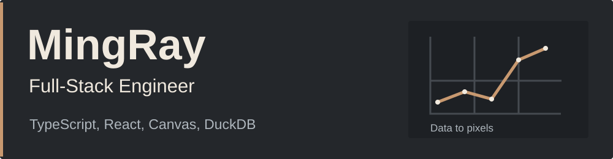
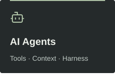
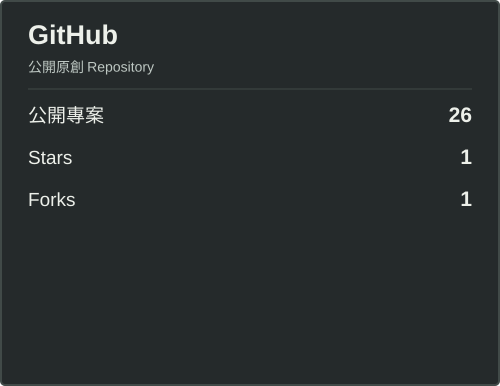
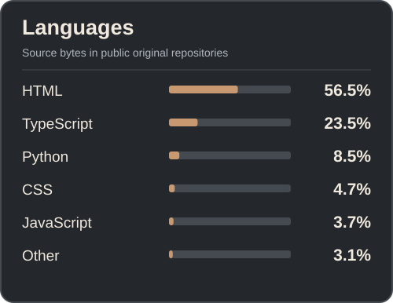

<picture>
  <source media="(max-width: 600px)" srcset="assets/header-mobile.svg" />
  
</picture>

# MingRay｜工程實作與技術判斷

我是 MingRay，一位 Full-Stack Engineer。目前的工作圍繞大型資料與圖表：資料如何查詢、如何進入 Renderer，以及 UI 如何回應使用者操作。

工作之外，我做可重用的元件與小型應用，也把工程問題、技術選擇的理由與驗證方式寫成繁中筆記。

  <a href="https://ntustray.github.io/mr-blog/"> 閱讀部落格</a>　
  <a href="https://github.com/ntustRay?tab=repositories"> 公開專案</a>　
  <a href="https://www.npmjs.com/package/@ntustray/react-datetime-range-picker"> npm 套件</a>

##  技術探索地圖

  
  
  

- **圖表與瀏覽器資料**：Query／Render 邊界、座標轉換、DPR，以及資料與 Render Cache 的記憶體成本；也在探索 Web Workers 與 OPFS。
- **React 與元件 API**：Controlled State、明確的資料契約與驗證，讓需求變動時仍能維持相容性。
- **工程工作流程**：Behavior Tests、Code Review、套件使用端驗證，以及人與 Coding Agent 都能理解的專案文件。

##  工程實作：MR Blog

[**MR Blog**](https://ntustray.github.io/mr-blog/) 用來保存技術探索與工程判斷，本身也採用可查看的實作：

-  **Static-first**：Astro、TypeScript 與 Markdown，部署到 GitHub Pages；[Content Collection schema](https://github.com/ntustRay/mr-blog/blob/main/src/content.config.ts) 驗證文章 metadata。
-  **內容檢索**：Build 時產生 Pagefind 索引，[搜尋頁](https://ntustray.github.io/mr-blog/search/)提供標題與內文檢索。
-  **品質檢查**：[Quality workflow](https://github.com/ntustRay/mr-blog/blob/main/.github/workflows/quality.yml) 執行 Build、內部連結檢查與 Lighthouse CI。
-  **延後載入留言**：[giscus 元件](https://github.com/ntustRay/mr-blog/blob/main/src/components/ArticleComments.astro)在接近可視範圍或手動開啟時載入；有留言時自動展開。

##  從這三篇開始讀

###  Agent 的能力，如何受到 Harness 影響？

[**[Insight] Coding Agent 需要多少 Harness？176 組實驗的條件與取捨**](https://ntustray.github.io/mr-blog/posts/coding-agent-harness-176-configurations/)

解讀 Planning、Tools 與 Context 設定的研究結果，釐清條件與取捨，再整理可用於自身工作流的驗證方式。

###  刷題與白板題，怎麼連到職場的工程能力？

[**[Insight] AI 都會寫程式了，刷 LeetCode 還在練什麼？**](https://ntustray.github.io/mr-blog/posts/ai-era-leetcode-thinking/)

從對齊 Spec、Input／Output，到第一版解法、迭代與溝通，整理我認為值得帶回職場的基本功。

###  工具省下的時間，應該怎麼算？

[**[Insight] Bun + Biome：讓 Agent 每次重跑都快一點**](https://ntustray.github.io/mr-blog/posts/bun-biome-agent-iteration-compound-time/)

以示意試算把環境準備與每輪檢查分開，討論工具省下的時間，如何轉成更有用的回饋。

[瀏覽全部文章 →](https://ntustray.github.io/mr-blog/archive/)

##  延伸作品

| 專案 | 用途與工程重點 |
| --- | --- |
|  [**React DateTime Range Picker**](https://github.com/ntustRay/react-datetime-range-picker) | 給分析、圖表與 Logs 使用的 React 範圍元件。Timestamp-first API、IANA 顯示時區、Draft／Commit 分離與半開區間 `[start, end)`。[Demo ↗](https://ntustray.github.io/react-datetime-range-picker/) · [API 契約](https://github.com/ntustRay/react-datetime-range-picker/blob/main/docs/PUBLIC_API.md) |
|  [**Agent Workspace Template**](https://github.com/ntustRay/agent-workspace-template) | 給 Coding Agent 清楚的專案入口：精簡的 AGENTS.md、架構文件，以及按任務使用的 Skills。 |

##  我如何與 AI 一起工作

<picture>
  <source media="(max-width: 600px)" srcset="assets/decision-mobile.svg" />
  
</picture>

- **Domain Knowledge 決定方向**：理解問題、辨認限制，才能判斷 AI 的答案是否適用。
- **找 Root Cause，說清楚 Trade-off**：把 AI 輸出當成提案，用證據與 pros／cons 和團隊討論。
- **先迭代，再增加設計**：從最小可驗證的改動開始，需求與重複出現的問題再決定抽象。
- **讓「完成」可以驗收**：Spec、Acceptance Criteria（AC）、代表性的 E2E 與 Definition of Done（DoD），都應指向可驗證的結果。
- **看懂 Diff，才合併**：查證不確定的行為，向團隊或 Domain Expert 請教，讓技術取捨有共同理解。

最新文章（每日更新）

<!-- BLOG:START -->
- [\[News\] Librarian Agents：讓 Agent 先整理文件，再回答問題](https://ntustray.github.io/mr-blog/posts/librarian-agents-query-independent-workspace/)
- [\[News\] MemHub v1.0.4：跨 Agent 記憶，要怎麼停止與刪除？](https://ntustray.github.io/mr-blog/posts/memhub-shared-memory-data-lifecycle/)
- [\[News\] DeepSeek 開放 Search／Fetch：多 Agent 得共用請求預算](https://ntustray.github.io/mr-blog/posts/deepseek-search-fetch-agent-budget/)
- [\[Insight\] AI 都會寫程式了，刷 LeetCode 還在練什麼？](https://ntustray.github.io/mr-blog/posts/ai-era-leetcode-thinking/)
- [\[News\] d1-ultra 回傳機率之後，Agent 何時該轉人工？](https://ntustray.github.io/mr-blog/posts/d1-ultra-probability-human-review/)
<!-- BLOG:END -->

更多作品、Repository 動態與語言統計

[Markdown Reader](https://github.com/ntustRay/markdown-file-reader)：以 Tauri 與 TypeScript 製作的本機 Markdown 編輯 Side Project。

<!-- REPOS:START -->
- [mr-blog](https://github.com/ntustRay/mr-blog) 2026-10-20
- [parallel-parking-lab](https://github.com/ntustRay/parallel-parking-lab) — 慢慢停 · 第一人稱路邊停車練習。坐進駕駛座，用左右後視鏡、轉頭觀察與低速控制練習倒車入位。 2026-10-19
- [react-datetime-range-picker](https://github.com/ntustRay/react-datetime-range-picker) — A React date-time range picker. 2026-10-19
- [agent-workspace-template](https://github.com/ntustRay/agent-workspace-template) — template for new general ai-agent 2026-09-28
- [markdown-file-reader](https://github.com/ntustRay/markdown-file-reader) — A Tauri-based Markdown reader with dark mode support 2026-09-18
<!-- REPOS:END -->

  
  

<!-- UPDATED:START -->
更新於 2026-10-20 · [GitHub Actions 每日更新](https://github.com/ntustRay/ntustRay/actions/workflows/update-profile.yml).
<!-- UPDATED:END -->

圖示採用 <a href="https://lucide.dev/">Lucide</a>，授權見 <a href="assets/readme/LICENSE-lucide.txt">LICENSE-lucide.txt</a>。
