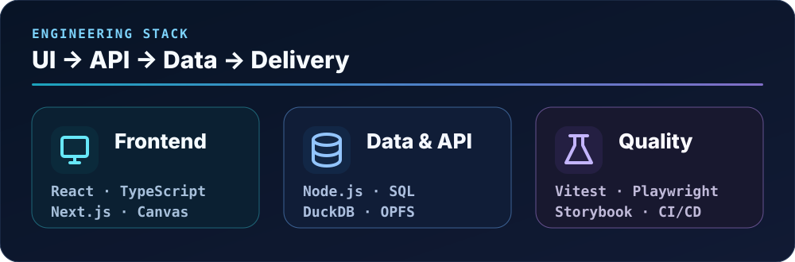
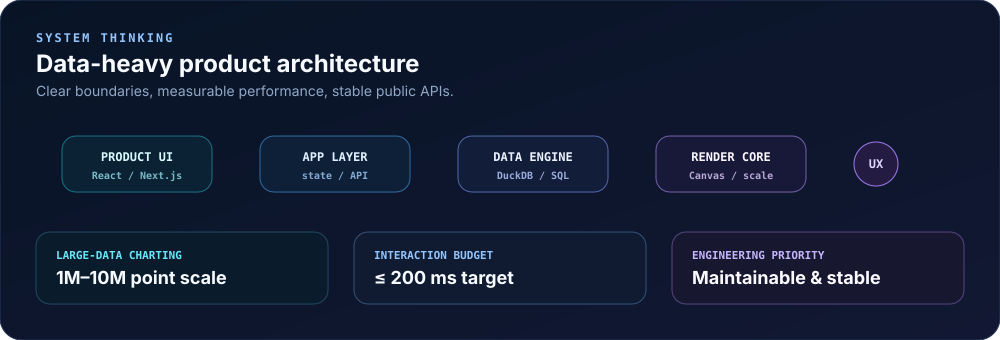
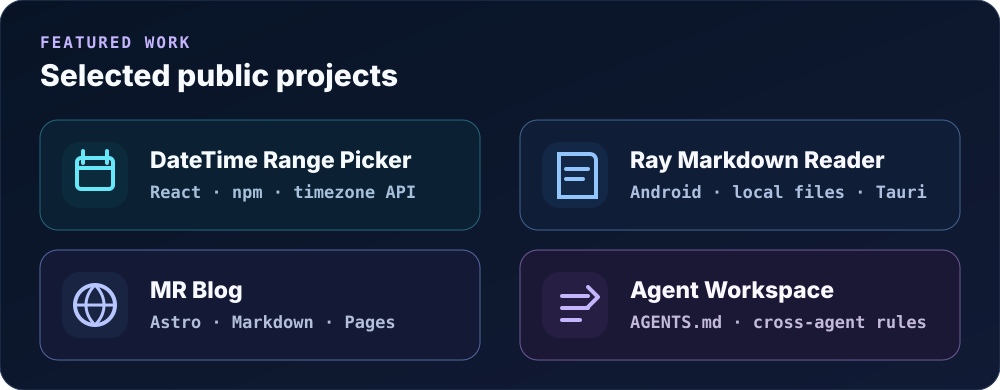

  

  <a href="https://ntustray.github.io/mr-blog/"><strong>Blog</strong></a>
  &nbsp;·&nbsp;
  <a href="https://github.com/ntustRay?tab=repositories"><strong>Projects</strong></a>
  &nbsp;·&nbsp;
  <a href="https://www.npmjs.com/package/@ntustray/react-datetime-range-picker"><strong>npm</strong></a>

## About

I'm **MingRay**, a **Full-Stack Engineer** focused on **data-heavy products**, **high-performance visualization**, and **maintainable systems**.

I work across **UI, API, and data layers** with React, TypeScript, Next.js, Node.js, SQL, and DuckDB.

  

## System thinking

  

## Featured work

  

  <a href="https://github.com/ntustRay/react-datetime-range-picker"><strong>DateTime Picker</strong></a>
  &nbsp;·&nbsp;
  <a href="https://github.com/ntustRay/markdown-file-reader"><strong>Markdown Reader</strong></a>
  &nbsp;·&nbsp;
  <a href="https://github.com/ntustRay/mr-blog"><strong>MR Blog</strong></a>
  &nbsp;·&nbsp;
  <a href="https://github.com/ntustRay/agent-workspace-template"><strong>Agent Workspace</strong></a>

## Engineering focus

- ⚡ **Performance** — Canvas, large datasets, progressive rendering, interaction latency.
- 🧩 **Architecture** — clear boundaries between UI, state, data processing, and rendering.
- 🛡️ **Compatibility** — stable APIs, migration thinking, safer releases.
- 🧪 **Quality** — Vitest, Playwright, Storybook, CI/CD.

## Latest articles

<!-- BLOG:START -->
- [Coding Agent 到底需要多少 Harness？176 組實驗拆開 Planning、Tools 與 Context](https://ntustray.github.io/mr-blog/posts/coding-agent-harness-176-configurations/)
- [Bun + Biome：讓 Agent 每次重跑都快一點](https://ntustray.github.io/mr-blog/posts/bun-biome-agent-iteration-compound-time/)
- [快訊：NVIDIA OpenShell，把 AI Agent 關進真正的安全邊界](https://ntustray.github.io/mr-blog/posts/nvidia-openshell-agent-security-boundary/)
- [React 團隊為什麼把 ESLint + Prettier 換成 Biome](https://ntustray.github.io/mr-blog/posts/why-we-replaced-eslint-prettier-with-biome/)
- [不要再只會 npm i：2026 我們為什麼改用 Bun](https://ntustray.github.io/mr-blog/posts/stop-using-npm-install-why-we-use-bun/)
<!-- BLOG:END -->

## Recently updated projects

<!-- REPOS:START -->
- [mr-blog](https://github.com/ntustRay/mr-blog) 2026-10-14
- [agent-workspace-template](https://github.com/ntustRay/agent-workspace-template) — template for new general ai-agent 2026-09-28
- [markdown-file-reader](https://github.com/ntustRay/markdown-file-reader) — A Tauri-based Markdown reader with dark mode support 2026-09-18
- [react-datetime-range-picker](https://github.com/ntustRay/react-datetime-range-picker) — A React date-time range picker. 2026-08-15
- [2026-korea-busan-travel](https://github.com/ntustRay/2026-korea-busan-travel) — The travel instruction 2026-07-30
<!-- REPOS:END -->

## GitHub at a glance

  
  

<!-- UPDATED:START -->
Updated 2026-10-14 · Public repositories only · [Daily refresh](https://github.com/ntustRay/ntustRay/actions/workflows/update-profile.yml)
<!-- UPDATED:END -->

  

